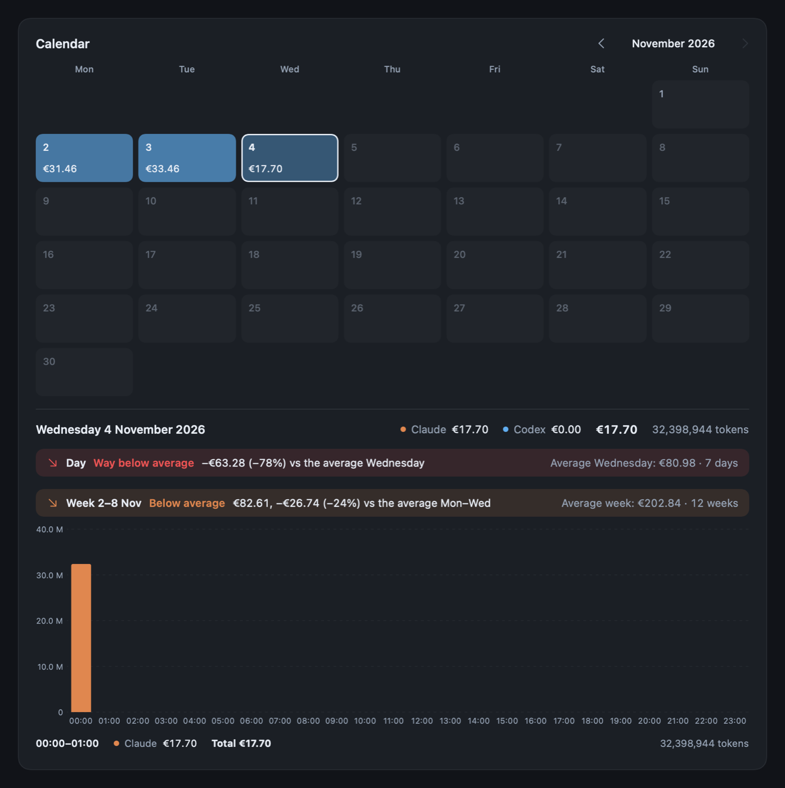

# EJAJ

A macOS menu-bar app that counts the tokens Claude Code and Codex use on this Mac and shows what they would cost at standard API prices. It reads the session logs both tools already write, and those stay on the Mac. The only things EJAJ fetches are the daily ECB exchange rate and, when Claude Code is signed in, the limits of your Claude plan.



The cost is what the same tokens would cost on the API. It is not a bill. If you pay for a subscription, think of it as how much use you got out of it.

Requires an Apple Silicon Mac with macOS 13 or later.

## Tutorial

### 1. Build and install

The quickest way is the zip from the [latest release](https://github.com/tadeaskaminsky/ejaj/releases/latest): unzip it, move `EJAJ.app` to `/Applications` (or any folder you can write to) and open it. The app is signed ad hoc, not notarized, so macOS blocks it the first time. Allow it with Open Anyway in System Settings > Privacy & Security. Later versions install from inside the app (see Updating), without that step.

To build it yourself you need the Xcode command line tools (`xcode-select --install`). No Xcode project is involved.

```bash
git clone https://github.com/tadeaskaminsky/ejaj.git
cd ejaj
scripts/package.sh
```

That builds the app, runs the tests and leaves `build/EJAJ.app` plus `build/EJAJ-macOS.zip`. Move the app wherever you keep it, for example:

```bash
ditto build/EJAJ.app /Applications/EJAJ.app
open /Applications/EJAJ.app
```

The app is signed ad hoc, not notarized. That's fine on the Mac that built it. A copy from the zip on another Mac gets blocked the first time. Allow it with Open Anyway in System Settings > Privacy & Security.

### 2. The menu-bar icon

EJAJ has no Dock icon. It lives in the menu bar as a small waveform.

- **Click** it for the quick view: today's cost, tokens per tool and a verdict comparing today with the same weekday over the past 12 weeks. The quick view is in Slovak, on purpose. In euros, a small line under the amount gives the same cost in dollars and the ECB rate used, so you can hold it against a USD price list or another tool.
- **Right-click** it for a line with today's cost (with dollars in brackets when you count in euros) and tokens, then Open EJAJ, Refresh data, Archive to GitHub, Launch at login and Quit.
- **Dashboard** in the quick view (or `⌘O`) opens the main window. It fills the screen between the menu bar and the Dock, on the display whose menu bar you clicked, and the content stretches to the full width. A double-click on the title bar shrinks it to the size it had last time (1000 x 760 at first), and another one fills the screen again. Each time you open it, it fills the screen.

The data refreshes every 30 seconds. The first scan of a long history can take a few seconds, and after that only changed files are read again.

### 3. The dashboard

The switch next to the EJAJ mark picks the tab: **Overview**, **Calendar**, **Projects**, **Sessions** or **Patterns**. The window remembers the last one. On the right are Refresh (hover it to see when the logs were last read), the gear menu and Archive.

The two pickers under it decide what every tab shows. **Platform** is All, Claude or Codex. **Range** is Today, 7, 30 or 90 days, or All time. The Calendar tab moves by month, so it has no Range picker.

Overview has the token, API cost and cache totals and a chart per day (per hour for Today). The Tokens/Cost switch above the chart picks what it measures. Hover the chart to see a day's figures underneath. With both platforms shown, a thin bar under each total splits it between Claude and Codex. If a model has no known price, the API cost card says how many tokens that leaves out.

Both total cards split their number into input, cache write, cache read and output. Most tokens are cache reads, usually over 90 %, and they cost a fraction of fresh input, so the token count alone says little about the bill. The cost card shows what each category adds up to, plus web searches when there were any. In euros it also gives the dollar total and the ECB rate under the big number.

**Cache saved** is what the prompt cache took off the bill. Cache reads cost a fraction of fresh input, and cache writes cost a bit more, so the card weighs both against paying the input price for every cached token. It shows the net saving, the share of the bill it cut, the two parts, and what the bill would have been without the cache.

The **Models** table lists every model with its tokens, requests, cache hit rate (the share of prompt tokens served from the cache), its share of the cost and the API cost. The bar is scaled to the most expensive model. Click a column header to sort, and click again to flip the order.

### 4. The calendar

The Calendar tab shows one month. Each day has its API cost, and darker days cost more. The month's most expensive day has a flame, and today's date is on a dark badge. With both platforms shown, a thin bar under a day's cost splits it between Claude and Codex. A `*` means the day includes tokens of models without a price. Use `‹` and `›` to change the month, and **Today** to come back.

Above the grid, **Claude week** shows how much of your Claude plan's weekly limit is left, the same numbers as `/usage` in Claude Code. It gives the share used, when the week resets and where the week is heading at the pace so far ("on pace for 83%"). When that pace would hit the limit before the reset, the banner turns red and says roughly when it runs out. Orange means a good part of the week's limit would go unused. On the right are the per-model weekly limits (Fable, for example) and the 5-hour limit. The numbers are read every 5 minutes, and a click on the banner reads them again.

The banner uses Claude Code's login from the Keychain (the "Claude Code-credentials" item), so it needs Claude Code signed in on this Mac: run `claude` in Terminal, then `/login`. The Claude desktop app keeps its own login, which EJAJ can't use. When the login has expired, EJAJ renews it the way Claude Code does and saves the new one back to the Keychain, so Claude Code keeps working with it. The endpoint and the renewal aren't documented by Anthropic and can change. If a read fails, the banner keeps the last numbers and says when they are from. On an API-key login there are no plan limits and the banner stays hidden.

Click a day to see its totals per tool, its hour-by-hour chart and two banners:

- **Day** compares the day with the same weekday over the 12 weeks before it, for example this Wednesday against the average Wednesday. When there are no earlier Wednesdays yet, it uses the 30 days before instead.
- **Week** compares the day's Monday to Sunday week with the 12 weeks before it. While a week is still running it is compared with the same days of earlier weeks. On a Wednesday that means Mon-Wed against Mon-Wed, so you don't see "way below average" every Monday morning. On the right is the average full week.

Both banners use the same scale. Way above average is 1.5x or more, Above is over 1.1x, Average is 0.9x to 1.1x, Below is 0.5x to 0.9x, and Way below is anything less. Days and weeks with no cost at all are left out of the averages. The Platform picker applies to the calendar too, so with Claude selected you compare Claude with Claude.

### 5. Projects, Sessions and Patterns

**Projects** lists what each project cost in the chosen range and platform, most expensive first. A bar shows how it compares with the top project. Under each name you see how many sessions it had and how many tokens they used. Hover a row to see the project's folder.

Click a project to see its cost, tokens and sessions, and a table of its sessions with when each started, how long it ran from the first request to the last, its tokens and its cost. Click a column header to sort. Click a session for its own breakdown: cost and tokens per category, start, last request, number of requests, folder and the models it used. The links at the top take you back.

A session is one Claude Code conversation with its subagents, or one Codex thread with the threads it spawned. Its project is the git repository around the folder it last worked in, so a session in a subfolder or in a Claude Code worktree (`.claude/worktrees/…`) counts toward the repository. A folder outside any repository is its own project. Claude's and Codex's scratch folders are grouped as **Scratch**, and temporary folders as **Temporary**. Projects with the same folder name count as one.

Titles are the ones you see in the apps: the name you gave a Claude Code session or else the one it generated, and the Codex thread name. Codex threads without a name show as "Untitled" with the start of their id. With a range other than All time, a session that started earlier counts only its days inside the range, and its page says so. A `*` next to a cost means it leaves out tokens of models without a price.

**Sessions** starts with **Running now**: every session that sent a request in the last 10 minutes, with what it cost today, and for a session that started on an earlier day also what it cost in total. Running now ignores the range picker. Under it are the range's record sessions (most expensive, most requests, most tokens), and then every session across projects in one table with its project. Type in the search field to find sessions by title or project. A click on any of them opens the session.

**Patterns** shows when in the week the money goes. Each square is one hour of a weekday, darker for more spent in the chosen range. On the right is each weekday's total, and under the grid each hour's total. Hover a square for its cost, the average for one such day, its tokens and requests. With Today chosen, Patterns shows only today instead: one larger tile per hour with its cost written in, the current hour ringed and the hours still to come outlined.

**Christmas edition.** From 1 December to 6 January a string of twinkling lights hangs across the top of the dashboard and the quick view, the logo wears a Santa hat, today's date is on a red badge, the month's most expensive day gets a gold star instead of the flame and 24 December a present. Switch it on or off any time with Christmas edition in the gear menu. With Reduce Motion on in macOS, the lights stay lit instead of twinkling.

### 6. Settings

The gear icon in the dashboard has the settings.

- **Currency**: EUR (default, converted at the daily ECB rate) or USD.
- **Appearance**: Dark, Light or System.
- **Count from**: leaves out everything before the day you pick. Next to the first record it offers every day you came back after 30 or more days without use, so a lone test session months before you started for real doesn't stretch All time. The totals, the chart, the calendar and the quick view's comparison all start on that day, and with All time selected the dashboard says so under the pickers.
- **Launch at login**: registers EJAJ as a login item. It shows up in System Settings under General > Login Items.
- **Edit prices (pricing.json)**: opens `~/Library/Application Support/EJAJ/pricing.json`, creating it with the bundled prices the first time.

Prices are in USD per million tokens, in this order: input, cache read, cache write, output, 1-hour cache write. A model can have one list of rates, or a list of dated entries that each apply from that day on:

```json
{
  "claude-opus-5-5": [4, 0.2, 5, 20, 8],
  "gpt-6.1-sol": [
    { "from": "2026-01-01", "rates": [2, 0.2, 2.5, 10, 4] },
    { "from": "2026-10-01", "rates": [2, 0.1, 2.5, 10, 4] }
  ]
}
```

Some requests cost more than the list price, and EJAJ prices each request on its own:

- **Fast mode.** Claude Code writes `"speed": "fast"` on the response. Codex writes `"service_tier": "priority"` (EJAJ takes `"fast"` too) in a settings snapshot before each turn, except before the first turn in builds older than 0.163. So a Codex log starts in the tier of its first snapshot, and a subagent without one runs in its parent's tier at the time it was spawned. Fable 5.2, Opus 5.5, Opus 5 and Opus 4.8 cost 2x. GPT-6 and GPT-5.6 cost 2x, gpt-5.5 2.5x.
- **Long prompts.** Haiku 5.5 costs 5x once a prompt passes 100,000 tokens, cache reads and writes included. OpenAI charges 2x input and 1.5x output past 272,000.
- **US-only inference.** `"inference_geo": "us"` costs 1.1x on every Claude rate.
- **Web search.** $10 per 1,000 searches, on top of the tokens.

These live in the same file. The object form takes `rates` (either form above), `fast` and `longContext`. Leave out what you don't change: a model keeps its bundled modifiers otherwise, and `"longContext": null` removes the premium. Two keys set the flat prices:

```json
{
  "claude-haiku-5-5": {
    "rates": [0.1, 0.01, 0.125, 0.5, 0.2],
    "longContext": { "above": 100000, "input": 5, "output": 5 }
  },
  "claude-opus-5": { "fast": 2 },
  "usOnlyMultiplier": 1.1,
  "webSearch": 0.01
}
```

Edit prices writes all of this out the first time, with every bundled model. From then on the file's values win, so a price a later EJAJ corrects stays as the file has it until you change it there or delete the file. Save the file and the next refresh picks it up. If an entry is broken, the dashboard names the model and that model keeps its bundled price and modifiers. The other entries still apply.

### 7. Archive (optional)

The Archive button runs `~/projects/token-archive/archive.py`, a separate script that saves a snapshot of the counts and pushes it to a git repository. If that script doesn't exist, the button says so and nothing else happens.

### 8. Updating

EJAJ checks the GitHub releases when it starts and every 6 hours. When there is a newer version, an **Update** button appears next to Refresh. Click it to see what changed, then **Install and restart**. EJAJ downloads the release, checks it against the SHA-256 checksum GitHub lists for the file and that it really is EJAJ of that version with an intact signature, replaces itself and opens again. Your settings and history stay. If the replacement fails, the old version stays and the dashboard says why when it opens. **Check for updates** in the gear menu checks right away.

The app has to sit in a folder you can write to, such as `/Applications` on an admin account. If it runs straight from Downloads, macOS may run it from a read-only copy, and the update says so; move it to `/Applications` first.

If you build from source, pull and package again. To replace the copy you run and restart it in one step:

```bash
git pull
scripts/package.sh --install /Applications/EJAJ.app
```

`--install` only replaces a bundle whose identifier is EJAJ's, so a wrong path fails without deleting anything.

## Where the numbers come from

- **Claude Code**: `~/.claude/projects/**/*.jsonl`, `~/.config/claude/projects` and `$CLAUDE_CONFIG_DIR/projects` when they exist
- **Codex**: `~/.codex/sessions` and `~/.codex/archived_sessions` (plus the same folders under `$CODEX_HOME`), `.jsonl` and the compressed `.jsonl.zst` rollouts

EJAJ reads only the token counts, model names, timestamps and the fields that change the price (speed, service tier, inference geo, web search count) from those files, never prompts or tool output. For the Analytics tab it also reads each request's session id and working folder, the session titles, and Codex thread names from `session_index.jsonl`. It saves the project's name and folder with each session, not the full working path. Repeated records are counted once, also across folders, and a folder reached twice through a symlink is read once. The environment variables only count when EJAJ itself sees them, so for the app started from Finder or at login that is usually never. The last result is cached in `~/Library/Application Support/EJAJ/history.json` so the app opens with numbers straight away. Days are Europe/Bratislava days.

## Development

```
Sources/        main.swift (app, menus, icon), Models.swift (collector, pricing, averages), Plan.swift (Claude plan
                limits, Keychain login), Views.swift (SwiftUI)
Tests/          Tests.swift (collector, prices, calendar math) and WindowTests.swift (needs SwiftUI and a
                window server), plain executables of preconditions
Vendor/zstd/    static libzstd 1.5.7 (BSD licence in Vendor/zstd/LICENSE)
Resources/      Info.plist and AppIcon.icns
scripts/        build.sh, package.sh, render-calendar.sh
.claude/skills/ build-and-test, release, check-calendar-layout
```

- `scripts/build.sh` builds `build/EJAJ` and runs the tests.
- `scripts/render-calendar.sh` renders the calendar from your cached history to `build/calendar.png`, which is handy for checking that the banners fit. A third argument adds the Claude week banner: `plan` with sample numbers, `signedout` with its sign-in note, `live` with your real numbers.
- `build/EJAJ --snapshot out.json` writes what the collector found as JSON, without starting the app.

The version lives in `Resources/Info.plist`, and the history is in [CHANGELOG.md](CHANGELOG.md). If you work on this with Claude Code, the skills in `.claude/skills` cover building, releasing and checking the calendar layout.
